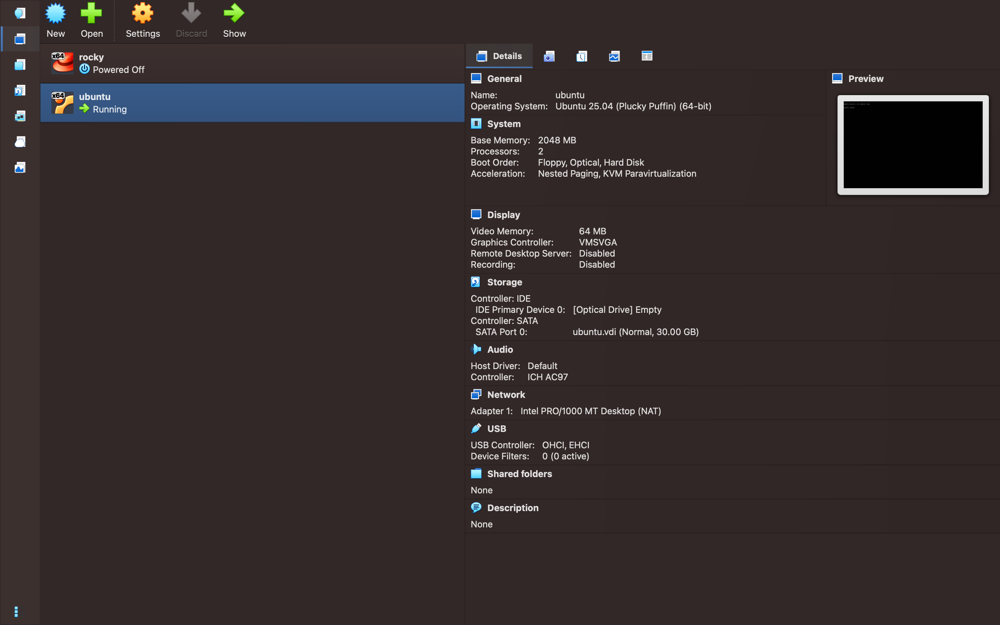
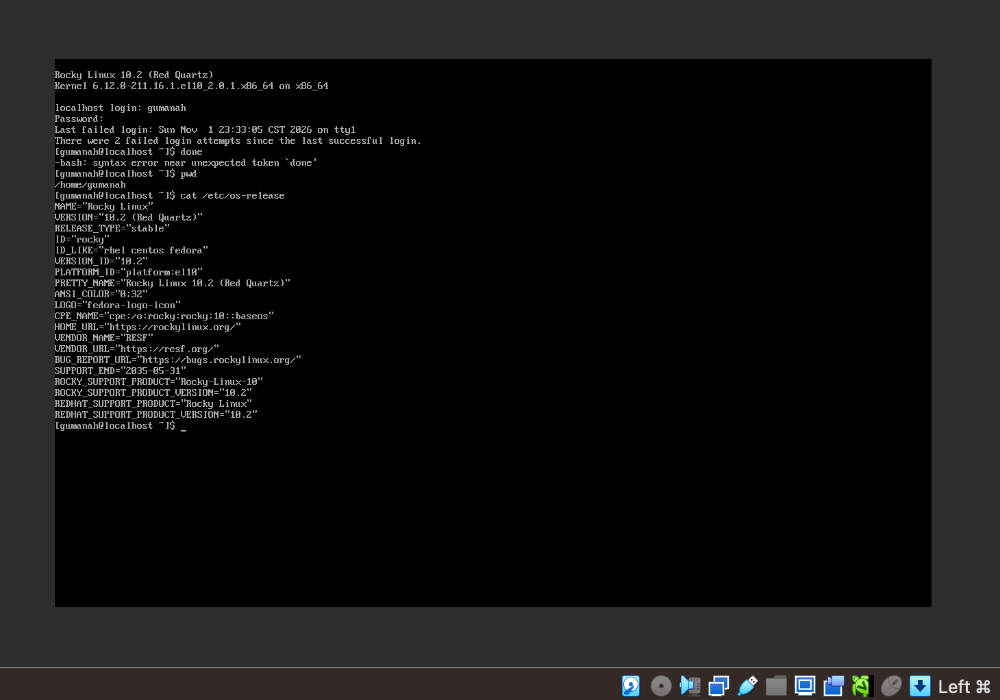
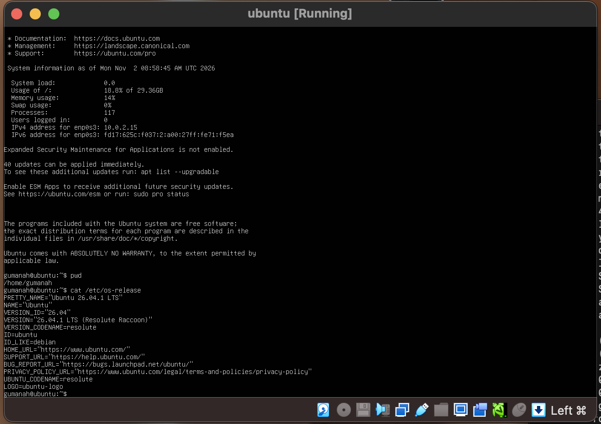
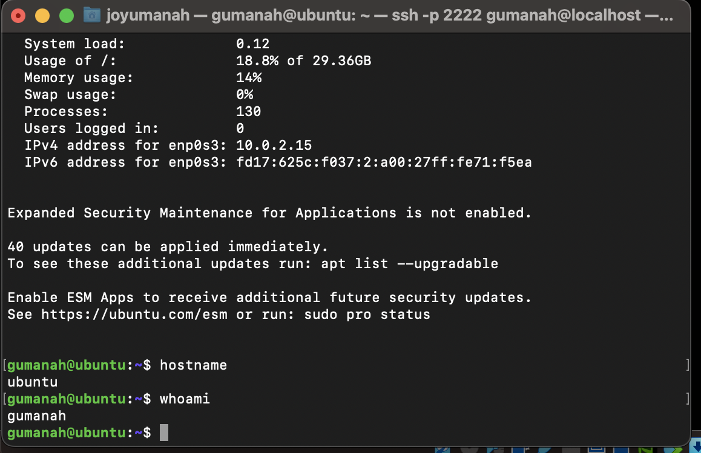
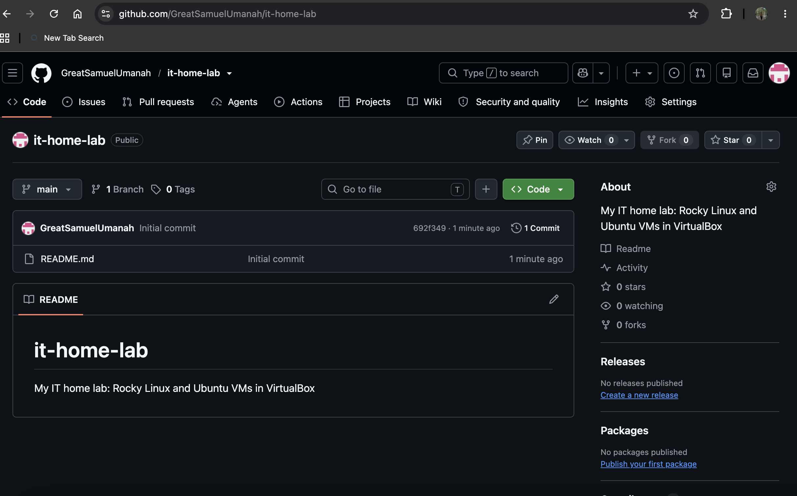

# IT Home Lab

## What I Built
I built a small practice lab on my Intel Mac with 8 GB of RAM. It has two Linux servers running as virtual machines in VirtualBox: Rocky Linux 10.2 and Ubuntu Server 26.04 LTS. I installed both by hand and connected to Ubuntu from my Mac using SSH with a key instead of a password.

## Tools Used
- VirtualBox
- Rocky Linux 10.2
- Ubuntu Server 26.04.1 LTS
- macOS Terminal
- SSH (key-based login, port forwarding)
- GitHub

## How It Works
```text
Mac (host)
 |-- VirtualBox
 |    |-- VM 1: Rocky Linux 10.2   (2 GB RAM, 40 GB disk)
 |    |-- VM 2: Ubuntu Server 26.04 (2 GB RAM, 30 GB disk)
 |-- Terminal --SSH (port 2222 -> 22)--> Ubuntu VM
 |-- GitHub (this repo)
```

## Steps
1. Installed VirtualBox on the Mac.
2. Created and installed the Rocky Linux VM by hand.
3. Created and installed the Ubuntu Server VM by hand.
4. Practiced basic commands: pwd, ls, cd, mkdir, touch, cat, nano, sudo, ip a, ping.
5. Added a port-forward rule (host port 2222 to guest port 22) so my Mac can reach the Ubuntu VM.
6. Connected from my Mac with SSH and switched to key-based login.
7. Created this GitHub repo and uploaded my screenshots.

## Screenshots

### P0-01 — VirtualBox With Both VMs

Shows that both virtual machines, rocky and ubuntu, exist in VirtualBox.

### P0-02 — Rocky Linux First Login

Proves Rocky Linux 10.2 is installed and I can log in as a normal user.

### P0-03 — Ubuntu First Login

Proves Ubuntu Server 26.04.1 LTS is installed and I can log in.

### P0-04 — SSH Into the VM From My Computer

Proves I can control the Ubuntu VM remotely from my Mac's Terminal using SSH.

### P0-05 — First GitHub Repo

Proves this repo exists publicly on GitHub.

## Troubleshooting Tickets
**VM showed a black screen.**
- How I found it: the VM said Running, but nothing was drawn on screen, and Settings showed an "Unattended" helper file in the virtual disc drive instead of the Rocky installer.
- Cause: the automatic (unattended) install did not start properly.
- Fix: powered off, put the real Rocky ISO in the drive, raised video memory to 64 MB, and installed by hand.

## What I Learned
- A virtual machine is a pretend computer running inside my real one.
- Reading error messages carefully solves most problems, like mixing up the number 1 and the letter l, or typing a command in the wrong window.
- SSH keys are safer than passwords, and the private key never leaves my Mac.
- Port forwarding lets my Mac reach a VM on a private virtual network.
- Screenshots and a clear README are proof of my work.
